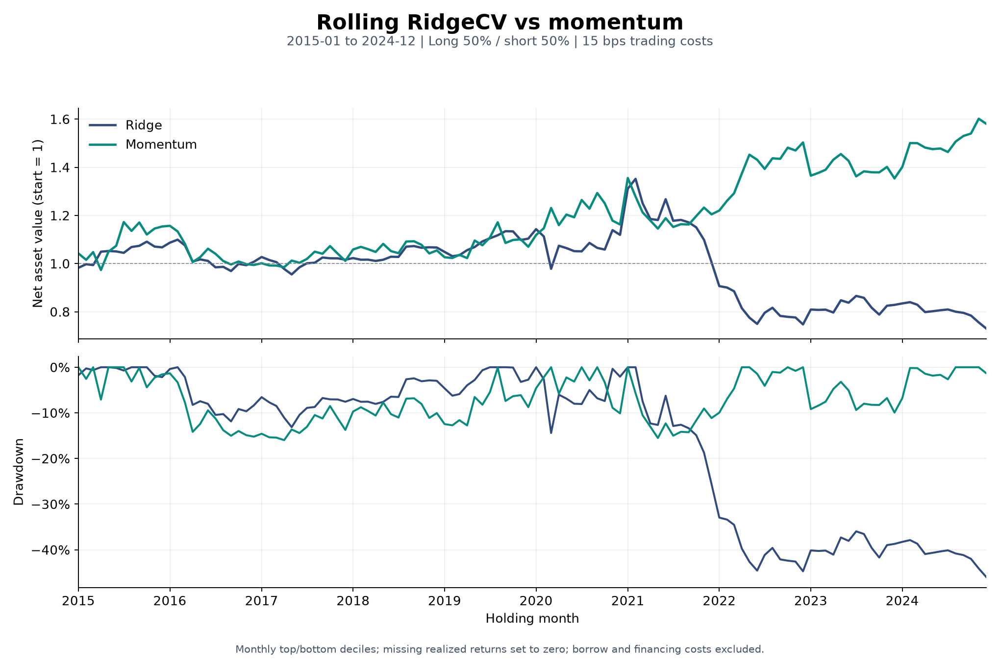
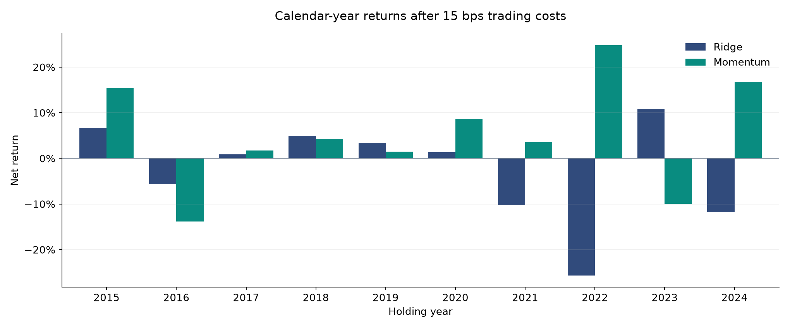

# buyside1

A quantitative research project studying how predictive information translates into tradable returns under changing market conditions, execution frictions, and information delays.

The research agenda has three parts:

- **Adaptive equity alpha:** test whether adapting forecasts and shrinking uncertain signals improves performance after trading costs.
- **Queue-aware execution:** measure how much queue position adds to fill probability and adverse-selection estimates.
- **Disclosure changes:** test whether changes in SEC filings add predictive information beyond fundamentals and price signals.

The current equity prototype compares seven-feature RidgeCV forecasts with a direct momentum benchmark. Each model uses a five-year rolling training window and forecasts the following year, covering holding months from January 2015 through December 2024. Both strategies buy the top prediction or momentum decile and short the bottom decile, with long weights totaling +50%, short weights totaling -50%, and 15 bps trading costs per unit of absolute traded weight. Missing realized returns are temporarily assigned zero.

The latest run documents a negative result for the learned model: Ridge underperforms the momentum benchmark under the current data and implementation assumptions. The repository also contains a C++ L3 order-book prototype and a small SEC 10-K downloader. Adaptive forecasting, queue-outcome models, and disclosure-change analysis remain planned research. The approaches below distinguish these prototypes from the intended studies.

| Research area | Implemented | Still needed |
| --- | --- | --- |
| Equity alpha | CRSP ingestion, monthly universe/features, rolling RidgeCV, momentum comparison, backtest, and aggregate result export | Chronological internal validation, missing-return reconciliation, executable trade timing, adaptation, and common risk/turnover constraints |
| Queue-aware execution | In-memory C++ order book with order updates and queue tracking | Exchange-feed replay, sequence validation, timestamps, hypothetical execution rules, and calibrated outcome models |
| SEC disclosures | Sample 10-K metadata/HTML downloader and initial section-boundary patterns | Complete historical filing coverage, working section extraction, security linkage, text-change features, and return evaluation |

## Latest Results: RidgeCV vs Momentum

Snapshot generated on **November 5, 2026**, from the current local CRSP-derived Parquet files. Results include the current 15 bps transaction-cost model, exclude borrow fees and financing costs, and use the missing-return zero-fill policy described below.

| Metric, January 2015–December 2024 | RidgeCV, seven features | Momentum benchmark |
| --- | ---: | ---: |
| Net CAGR | **-3.09%** | **4.68%** |
| Annualized Sharpe, risk-free rate = 0 | -0.181 | 0.417 |
| Maximum monthly-observed drawdown | -45.96% | -15.98% |
| Average monthly turnover, `sum(abs(weight change))` | 153.35% | 67.52% |
| Held stock-month returns assigned zero | 31 | 22 |

The model has lower realized returns, a deeper drawdown, and higher turnover in this inspected development sample. Dollar-neutral weights do not establish market-beta neutrality, and these statistics are portfolio outcomes rather than estimates of factor-adjusted alpha. They do not establish future performance or validate the missing-return assumption.





The aggregate data behind these figures are checked in:

- [Summary metrics](docs/results/summary.csv), [calendar-year results](docs/results/annual_results.csv), and [monthly portfolio results](docs/results/monthly_results.csv).
- [Selected alphas and training-window sizes](docs/results/selected_alphas.csv).
- [Run settings, package versions, and SHA-256 fingerprints](docs/results/manifest.json) for source files, local inputs, and exported artifacts.

The CSV files contain portfolio-level aggregates and model settings, not stock-level licensed market data. Regenerate the snapshot with `uv run python scripts/export_results.py --as-of 2026-11-05` after preparing the local inputs. The exporter executes the existing strategy and verifies the returned portfolio results before producing the figures and CSV files.

## 1. Adaptive Equity Alpha under Distribution Shift and Trading Costs

**Research question:** Can models that adapt to changes in predictive relationships outperform fixed-window models when risk, turnover, and trading costs are held comparable?

**Target dataset:** Approximately 1,000 U.S. equities per month over 2010–2024, with earlier observations used for feature and liquidity lookbacks.

### Approach

1. **Build a point-in-time universe.** At each month-end, rank eligible stocks by their previous 60 trading days of average dollar volume. Select up to 1,000 stocks with a price of at least $5 and sufficient valid history for the following month. Preserve historical membership as stocks enter, leave, or delist. Finalize issuer eligibility before freezing the sample; the current downloader filters U.S. listing venues but does not require U.S. incorporation.
2. **Construct features and labels.** Start with lagged returns, momentum, reversal, volatility, and liquidity features to forecast next-month returns. Fit imputation, scaling, and any feature selection within each training window using only information available at the forecast date.
3. **Establish forecasting baselines.** Compare Ridge and LightGBM using fixed rolling windows and an expanding-window benchmark, with the same features and prediction horizon.
4. **Introduce adaptation and uncertainty shrinkage.** Test recent-performance weighting and adaptive training windows. Use historical validation errors and model disagreement as uncertainty proxies, shrinking less reliable forecasts toward zero. Select adaptation and shrinkage settings using past validation periods.
5. **Translate forecasts into portfolios.** Apply the same exposure limits, risk target, rebalance schedule, and turnover budget across models. Report whether realized risk and turnover remain comparable. Begin with proportional trading costs, then test higher costs and liquidity-dependent assumptions.
6. **Evaluate chronologically.** Use past data for fitting and parameter selection, and keep forward-return labels from crossing split boundaries. The original design proposed a 2022–2024 final holdout, but the current rolling experiment has already inspected 2015–2024. Those years are now development evidence; further model selection needs a separately reserved, previously uninspected period or a forward evaluation.

**Evaluation:** Forecast error and rank correlation; gross and net returns; Sharpe ratio; maximum drawdown; realized risk; turnover; and break-even trading costs. Ablate adaptation and uncertainty shrinkage separately to identify their contributions.

## 2. Queue-Aware Fill Probability and Adverse Selection

**Research question:** Does knowing an order's place in the queue improve execution forecasts beyond price-level order-book and order-flow information?

**Target dataset:** Order-level messages for one equity index futures contract across approximately 30 trading sessions. Contract selection and data access remain to be established.

### Implemented Prototype

[`orderbook/orderbook.cpp`](orderbook/orderbook.cpp) defines an in-memory `L3OrderBook` using an order-ID hash map, ordered bid/ask price maps, and doubly linked FIFO queues within each price level. Prices are integer ticks; quantities and internally assigned priority sequences are integers.

- `on_add` appends an order to its price level, ignoring zero quantities and duplicate live IDs.
- `on_reduce_or_remove` handles partial reductions and complete removals, clamps reductions to the remaining quantity, and updates tracked quantity ahead/behind. Complete removal marks a tracked real order as filled or canceled according to the event flag; partial fills leave it active.
- `on_modify` preserves priority for a quantity decrease at the same price. A price change or quantity increase removes and re-adds the order with a new priority; tracking that replacement requires another `track_newly_added_order` call.
- `track_newly_added_order` tracks a real order's queue position. `inject_hypothetical_oder` tracks a hypothetical position without inserting displayed liquidity. Its placement ratio is rounded to a boundary between whole orders; it does not split an existing order's quantity.

Hypothetical orders track queue movement only and never transition to a filled outcome. The class has no feed adapter, external exchange sequence validation, event timestamps, snapshot validation, executable entry point, or statistical model. Its internal sequence describes call order; exchange-specific matching and priority rules still need a separate replay layer.

### Approach

1. **Reconstruct the order book.** Process additions, modifications, cancellations, and executions in exchange sequence. Validate reconstruction against available snapshots and the selected contract's matching rules. Track order identifiers, queue priority, and quantity ahead.
2. **Define order outcomes.** Start with time to first fill versus cancellation as competing outcomes. Treat orders still resting at the observation boundary as censored, and distinguish partial fills from complete fills in subsequent analysis.
3. **Build features and benchmarks.** Use queue position, quantity ahead, spread, depth imbalance, recent trades, and cancellation intensity. Compare a model using only price-level and flow features with one that also includes queue information.
4. **Test chronologically and calibrate probabilities.** Separate training, calibration, and final testing by session. Compare probability calibration, Brier score, and fill-versus-cancellation performance at prespecified horizons.
5. **Measure execution quality.** Calculate signed post-fill midprice markouts at fixed horizons to assess adverse selection. Repeat the analysis under delayed order arrival and different hypothetical queue placements, documenting the replay assumptions.

**Evaluation:** The incremental forecasting value of queue features, probability reliability, post-fill markouts, and sensitivity to latency. Historical-order prediction and hypothetical-order replay will be reported separately.

## 3. Incremental Information in SEC Disclosure Changes

**Research question:** Do changes in annual disclosures improve return forecasts after accounting for numerical fundamentals and price-based signals?

**Target dataset:** Approximately 5,000 annual filings from 500 U.S. issuers over 2015–2024, subject to filing availability. Earlier filings may be needed to establish the first year-over-year comparisons.

### Implemented Prototype

[`SEC/unverse_and_edgar.py`](SEC/unverse_and_edgar.py) selects the first five entries returned by the SEC company-ticker endpoint, fetches each issuer's recent submissions, and downloads primary documents for exact `10-K` forms with filing years in 2015–2024. This sample is not a historical investable universe. The saved index includes CIK, form, filing/report dates, acceptance timestamp, accession number, document URL, local path, and download status.

HTML files and `filing_index.parquet` are written to `SEC/data/raw_filings/`, relative to the working directory. Downloads reuse existing files larger than 1,000 bytes and sleep 0.12 seconds before each uncached document request. The local cache inspected on November 7, 2026 contains 23 filings from five issuers, with filing dates between October 28, 2015 and November 1, 2024; these files are local artifacts excluded from Git.

The current downloader reads only `filings.recent`; it does not follow historical submission files, include `10-K/A` amendments, or guarantee complete coverage of the requested years. Non-200 metadata responses return no records, and failed document downloads are printed but omitted from the saved index. Historical coverage, retry handling, content validation, and an explicit failure log remain necessary.

[`SEC/section_parser.py`](SEC/section_parser.py) currently defines boundary patterns for Item 1A (Risk Factors) and Item 7 (MD&A). Its HTML cleaner constructs a BeautifulSoup object but returns `None`; no section extraction or output-writing loop exists. Its input path is also `SEC/data/filing_index.parquet`, which differs from the downloader's output path. Running this file does not produce `sections.parquet`. Acceptance timestamps are recorded, but trading-session alignment, issuer/security linkage, and disclosure-change forecasts are not implemented.

### Approach

1. **Build the filing panel.** Record SEC accession identifiers, issuer identifiers, reporting periods, and public acceptance timestamps. Link issuers to historically valid securities and map each disclosure to its first eligible trading session after a processing delay.
2. **Extract and align sections.** Identify MD&A and Risk Factors, align them with the previous annual filing, and filter repeated boilerplate. Audit extraction quality on a manually reviewed sample.
3. **Measure disclosure changes.** Begin with additions, deletions, section growth, textual novelty, and changes in risk-related language. Compare these with features based on the full section text.
4. **Test incremental information.** Compare a baseline using point-in-time numerical fundamentals and price signals with the same model augmented by disclosure-change features. Keep the stock sample, return horizon, and portfolio rules consistent.
5. **Validate robustness.** Develop models on earlier years and reserve later years for chronological testing. Run feature ablations and delayed-entry experiments, such as one, three, and five trading sessions after eligibility. Use historical fundamentals as available at the time rather than subsequently revised values.

**Evaluation:** Out-of-sample forecast improvement, rank correlation, and cost-adjusted portfolio performance. Test whether any benefit persists after removing boilerplate, changing entry delays, and controlling for numerical information.

## Shared Research Design

- **Information timing:** Record when an observation became available and when it could first affect a trade. Lag signals and portfolio weights accordingly.
- **Chronological validation:** Tune on earlier periods, respect label horizons at split boundaries, and keep final holdouts untouched during development.
- **Controlled comparisons:** Change one component at a time while keeping samples, targets, portfolio constraints, and cost assumptions comparable.
- **Reproducibility:** Save data definitions, feature versions, model settings, split dates, and experiment outputs. Report sensitivity and failed hypotheses alongside successful results.

## Current Implementation

| Component | Current scope |
| --- | --- |
| `scripts/pull_crsp_history.py` | Downloads yearly CRSP daily data; defaults to 2000–2025. Stores security identifiers, dates, returns, prices, volume, exchange, and trading status. |
| `scripts/pull_crsp_sample.py` | Downloads a 10-stock sample for the first half of 2024. |
| `scripts/build_universe.py` | Builds up to 1,000-stock monthly universes using 60-day average dollar volume, an absolute price floor of $5, 60 valid dollar-volume observations, and active status at formation. The default entry point exports holding months in 2010–2024. |
| `scripts/build_features.py` | Aggregates daily data for 2009–2024, constructs seven predictors and calendar-aligned next-month labels, and saves `data/silver/features.parquet`. New predictors include a shorter momentum window, maximum daily return, and Amihud illiquidity. |
| `scripts/build_panel.py` | Left-joins the monthly universe to features on `permno` and `holding_month`, enforcing one-to-one keys and retaining unmatched universe rows. The function returns a DataFrame; the script prints diagnostics without saving a separate panel. |
| `scripts/ridge.py` | Refits a median-imputation, standardization, and RidgeCV pipeline annually using five years of past data; compares forecast-ranked and momentum-ranked long-short deciles in 2015–2024 at 15 bps costs. Displays comparative NAV and prints summary metrics. |
| `scripts/export_results.py` | Runs the current strategy headlessly, checks portfolio calculations and exposures, and saves README figures, aggregate CSV results, annual alphas, and provenance metadata to `docs/results/`. |
| `backtest/engine.py` | Computes portfolio returns, weight drift, turnover, proportional transaction costs, NAV, and drawdown; includes plotting. Risk and turnover constraints remain to be implemented. |
| `scripts/demo_scripts/run_equal_weight.py` | Runs an equal-weight backtest on the 2024 sample with 10 bps trading costs. |
| `scripts/demo_scripts/ridge_demo.py` | Compares Ridge and Lasso on synthetic data. Its test-error-based parameter selection is exploratory; final research will use separate tuning and untouched test samples. |
| `scripts/demo_scripts/fused_lasso.py`, `scripts/demo_scripts/non_linear_model` | Synthetic structural-break, KNN, and kernel-smoothing examples. |
| `scripts/demo_scripts/histGBM.py` | Unfinished synthetic regime example; currently contains an `np.rando` typo and does not fit a forecasting model. |
| `orderbook/orderbook.cpp` | Standalone C++ class for FIFO order updates, real-order outcomes, and real/hypothetical queue-position tracking. No executable, feed replay, or hypothetical fill model. |
| `SEC/unverse_and_edgar.py` | Five-issuer 10-K metadata/HTML download prototype with acceptance timestamps and a local Parquet index. Recent submissions only; historical completeness is not established. |
| `SEC/section_parser.py` | Item 1A/7 boundary patterns and an unfinished HTML cleaner. Input-path mismatch and missing extraction/output logic prevent an end-to-end section pipeline. |
| `data/pit.py`, `data/linkage.py`, `data/silver/create_tables.sql` | Initial scaffolding for information timing, identifier linkage, and a DuckDB schema. Integration and validation remain in progress. |

### Feature and Label Timing

Each feature row is keyed by a stock and its information month `month`. Dates such as `2015-01-01` identify a month; they do not mean that its full-month return was known on the first day.

| Field | Current definition for information month `m` |
| --- | --- |
| `formation_date` | Last observed market date in month `m`, inferred from the input daily panel. |
| `observed_return`, `ret_1m` | Compounded available daily returns in month `m`. `ret_1m` currently copies `observed_return`. |
| `reversal_1m` | Negative of `ret_1m`. |
| `mom_12m` | Compounded returns from `m-11` through `m-1`: eleven months excluding the information month. The calculation reindexes the full monthly calendar before shifting and rolling. |
| `mom_6_2` | Compounded returns from `m-5` through `m-1`: five months excluding the information month, using the same calendar-aligned rolling calculation. |
| `vol_1m` | Sample standard deviation of available daily returns in month `m`, without annualization. |
| `adv_1m`, `log_adv_1m` | Average valid daily absolute price times volume in month `m`, and `log1p` of that average. |
| `maxret_1m` | Maximum available daily return in month `m`. |
| `amihud_1m` | Mean daily absolute return divided by dollar volume in month `m`. Zero or invalid dollar-volume denominators and nonfinite returns are excluded; `n_valid_amihud` records the contributing observations. |
| `holding_month` | Month `m+1`, whose return the model forecasts. |
| `target_ret_1m` | The same stock's `ret_1m` in month `m+1`, matched by calendar month. |
| `n_valid_returns` | Count of nonmissing daily returns in information month `m`; it does not certify complete coverage or valid numerical values. |

For example, the December 2014 feature row has `holding_month=2015-01-01` and a target equal to January 2015's realized return. For portfolio evaluation, the script separately reads `observed_return` from the full-market row with `month=2015-01-01` and aligns it to January's weights. It does not require the stock to remain in a later month's universe.

### Current Portfolio Experiment

1. Join universe membership to features using `permno` and `holding_month`. For each forecast year, use the preceding five calendar years with finite targets for training: 2010–2014 predicts 2015, 2011–2015 predicts 2016, through 2019–2023 predicting 2024.
2. Fit median imputation and standardization on the outer training window. `RidgeCV` then chooses among `alpha=[0.01, 0.1, 1, 10, 100]` using its default leave-one-out cross-validation and negative MSE scoring. In the exported run, 2015 and 2016 select 10; all later years select 100. These are grid choices, not global optima.
3. Forecast all monthly universe rows in the following year. Prediction eligibility is not filtered by future target availability. For the benchmark, use `mom_12m` directly, filling missing momentum with its median from the same outer training window.
4. Rank each month's stocks by forecast or benchmark momentum descending, breaking ties by `permno` ascending. Buy the top `floor(0.10 * number_of_stocks)` and short the same number from the bottom. Scores do not have to be positive for longs or negative for shorts.
5. Equal-weight the long side to +0.5 and the short side to -0.5. Both weight matrices cover the full evaluation calendar with zero weights for nonheld positions, including stocks entering or leaving the universe. This preserves entry and exit trades in turnover calculations.
6. Obtain each portfolio's realized returns independently from the full-market feature file using `month` and `permno`; the benchmark does not reuse a return matrix restricted to Ridge holdings. Mark zero-valid-return observations as missing, align the matrices, and fill missing returns with zero under the current temporary policy.
7. Run each strategy as one continuous monthly backtest with `initial_nav=1.0` and `transaction_cost_bps=15`. The engine does not shift weights internally. Costs equal `sum(abs(target weight - prior end weight)) * 15 / 10000`, so annual model refits do not reset portfolio turnover or NAV.
8. `ridge.py` plots the comparative NAV and prints CAGR, Sharpe, maximum drawdown, and average monthly turnover. `export_results.py` additionally saves summary, monthly, annual, alpha-selection, and provenance files plus NAV/drawdown and annual-return figures.

### Current Assumptions and Limitations

- **Missing realized returns:** Zero-filling applies to held stocks as well as nonheld positions. It assumes a zero monthly return, not a verified failed order, cash settlement, or delisting outcome. The existing `invalid_held` variable is computed after filling, only tests positive weights, and is not enforced; use the exporter's pre-fill count of nonzero-weight missing returns for diagnostics. Delisting and corporate-action reconciliation remain pending.
- **Monthly data quality:** The feature builder records coverage counts but does not enforce complete months. Its default product aggregation can turn entirely missing daily returns into a zero monthly return. The realized-return path masks zero-valid-return observations before its explicit zero-fill; this does not repair training features or labels, nor partial-month observations.
- **Execution timing:** Features use information through the formation close, while realized returns are calendar-month daily-return compounds. The prototype assumes monthly beginning weights; next-open fills, overnight gaps, execution delays, and order availability are not modeled. Calendar alignment alone does not establish executable, leakage-free returns.
- **Internal validation:** The outer rolling forecasts use only earlier years, but default RidgeCV leave-one-out folds are not chronological or month-grouped. Imputation and scaling are fitted on the full outer training window before this internal validation, rather than refitted within each validation fold. A lower internal MSE does not establish better future decile returns.
- **Evaluation and costs:** All 2015–2024 outcomes have been inspected during development, including the originally proposed holdout. Costs are a fixed 15 bps per absolute traded weight; market impact, stock-loan availability, borrow fees, and financing are absent. The cost/drift accounting and execution assumptions still require broader validation before treating this as an implementable portfolio.
- **Backtest input contract:** The engine checks for empty returns and a positive finite initial NAV, but does not enforce identical weight/return axes, finite input values, or a positive weight-drift denominator. Callers must align dates and columns and validate inputs before use; the result exporter adds checks for the current experiment.
- **Research scaffolding:** LightGBM forecasting, adaptive signals, constrained portfolio construction, exchange-feed reconstruction, and SEC section/change analysis are not implemented. `data/pit.py` fails to import because of a `pd.Dataframe` annotation typo; its session-boundary guard also uses `location > len(opens)` instead of `>=`. Identifier linkage remains a stub.

## Getting Started

Use Python 3.11 or later and run commands from the repository root. Install the current dependencies with `uv`:

```bash
uv sync
```

For the real-data workflow, download full calendar years including the 2009 feature and liquidity lookback. Supply your WRDS username:

```bash
export WRDS_USERNAME="your_wrds_username"
uv run python scripts/pull_crsp_history.py \
  --username "$WRDS_USERNAME" \
  --start-date 2009-01-01 \
  --end-date 2024-12-31
```

Then build the universe and features, and run the monthly strategy:

```bash
uv run python scripts/build_universe.py
uv run python scripts/build_features.py
uv run python scripts/ridge.py
```

The universe and feature scripts currently use defaults defined in their Python entry points; they do not expose date arguments through a CLI. The universe builder reads yearly files from 2009 through 2024 and writes `data/silver/universe_2010_2024.parquet`. The feature builder writes `data/silver/features.parquet`. `ridge.py` imports `build_panel.py`, which reads and prints local data during import. Run `ridge.py` as the script shown above; its root-path setup makes the sibling `backtest` package importable.

With generated Parquet files already available, only the last command is needed. To inspect the merged panel separately:

```bash
uv run python scripts/build_panel.py
```

To regenerate the README's aggregate figures and data without opening an interactive plot window:

```bash
uv run python scripts/export_results.py --as-of 2026-11-05
```

The output directory defaults to `docs/results/`; use `--output-dir` to choose another location. `--as-of` labels the snapshot and does not change the train/test dates. The manifest records local input fingerprints and source hashes so changes in results can be traced. Raw inputs are still required to regenerate the snapshot and are not distributed here.

Run the synthetic Ridge/Lasso demonstration without market data, or the separate ten-stock equal-weight sample:

```bash
uv run python -m scripts.demo_scripts.ridge_demo

# Requires WRDS_USERNAME and WRDS access for the sample download.
uv run python scripts/pull_crsp_sample.py
uv run python -m scripts.demo_scripts.run_equal_weight
```

### SEC Download Prototype

The SEC scripts use additional packages that are not declared in `pyproject.toml` or `uv.lock`: `requests` and `tqdm` for downloads, plus `beautifulsoup4` and `lxml` for the unfinished parser. Set `USER_AGENT` in `SEC/unverse_and_edgar.py` to your own application/contact identity before downloading. From the repository root, run the downloader with temporary additional dependencies:

```bash
uv run --with requests --with tqdm python SEC/unverse_and_edgar.py
```

The sample size and year range are set in the script's main block; there is no CLI for them. The section parser remains incomplete even if its dependencies are installed and its input path is corrected.

### C++ Order-Book Prototype

Use a C++17 compiler to check the standalone source:

```bash
clang++ -std=c++17 -Wall -Wextra -Wpedantic -Werror \
  -fsyntax-only orderbook/orderbook.cpp
```

There is no `main()` function, build system, or feed input. A replay application or test driver must instantiate `L3OrderBook` and supply events before this can run on market data.

Raw market data, generated Parquet datasets, local DuckDB files, and the entire `SEC/data/` cache are excluded from Git. WRDS credentials and licensed datasets must be supplied locally. The history downloader filters common equity and selected U.S. listing venues but does not require U.S. incorporation; these filters still need an audit for event and terminal-return coverage. Futures data requires separate access; LightGBM is not yet a dependency.

## Local Validation Snapshot

On November 5, 2026, both current strategies were run on the existing local Parquet files with a noninteractive plotting backend. Source compilation and TOML parsing passed. The export checks finite weights and outputs, complete evaluation calendars, +0.5/-0.5 side exposures, gross returns against weighted asset returns, compounded NAV, common costs, summary metrics against the strategy's own output, and one alpha record per forecast year.

| Check | Observed local result |
| --- | --- |
| Initial training stock-months, 2010–2014 | 59,970 |
| Rolling forecast years | 2015–2024, ten annual model fits |
| Forecast stock-months | 120,000 |
| Backtest periods | 120 months per strategy |
| Long / short holdings per month | 100 / 100 per strategy |
| Missing held monthly returns assigned zero | Ridge: 31; momentum: 22 |
| Matrix axes, finite weights/outputs, exposures, return and NAV checks | Passed |

The benchmark weight pivot is explicitly reindexed and zero-filled: missing stock/month positions must be zero weights so exits and entries are included in turnover. These checks validate the current calculation path and recorded assumptions, not completeness of market data or execution feasibility. Only aggregate output snapshots are committed; licensed stock-level inputs remain local.

On November 7, 2026, a fresh export to a temporary directory passed the existing checks and reproduced all four committed aggregate CSV files byte-for-byte; source and input fingerprints also matched. Syntax parsing passed for all 22 Python files, and project TOML parsing passed. These static checks do not imply every unfinished module imports or runs successfully.

The C++ source passed C++17 compilation with warnings treated as errors. A temporary assertion driver passed with AddressSanitizer and UndefinedBehaviorSanitizer, covering queue updates, partial/full reductions, modifications, hypothetical placement boundaries, invalid inputs, and hash-map rehashing. Offline SEC smoke checks passed for metadata form/year filtering, archive URL construction, and cached downloads; they also confirmed the parser's missing return and index-path mismatch. Live SEC downloads, exchange-feed replay, and a permanent regression suite were not part of this review.

## Next Steps

1. Reconcile missing held returns and terminal events, audit the downloader's filters, and validate daily inputs and partial-month coverage. Compare the current zero-return assumption with verified outcomes.
2. Use the exported momentum comparison as a fixed diagnostic baseline. Test feature groups, cross-sectional rank transformations, and model changes in prespecified training/validation periods, and retain local stock-level forecasts/weights for audit.
3. Replace default internal leave-one-out selection with chronological, month-grouped validation of the entire preprocessing/model pipeline. Compare expanding-window and nonlinear models, then freeze the design before a previously uninspected evaluation period; 2022–2024 cannot be claimed as untouched after the current analysis.
4. Align signals with executable trade times, evaluate liquidity-dependent costs and borrow assumptions, and introduce common exposure, risk, and turnover constraints before testing adaptation and uncertainty shrinkage. Consider holding buffers only after documenting the gross signal and its incremental value.
5. Connect the C++ order-book prototype to order-level futures data, validate exchange sequence and priority rules against snapshots, and define partial-fill/cancel/censoring labels before fitting queue models. Add an explicit execution model before interpreting hypothetical queue positions as fills.
6. Extend SEC metadata collection to historical submissions and preserve failed requests; declare the SEC dependencies, align index paths, and complete and audit section extraction. Then build historical security linkage and disclosure-change features before testing incremental return information.
